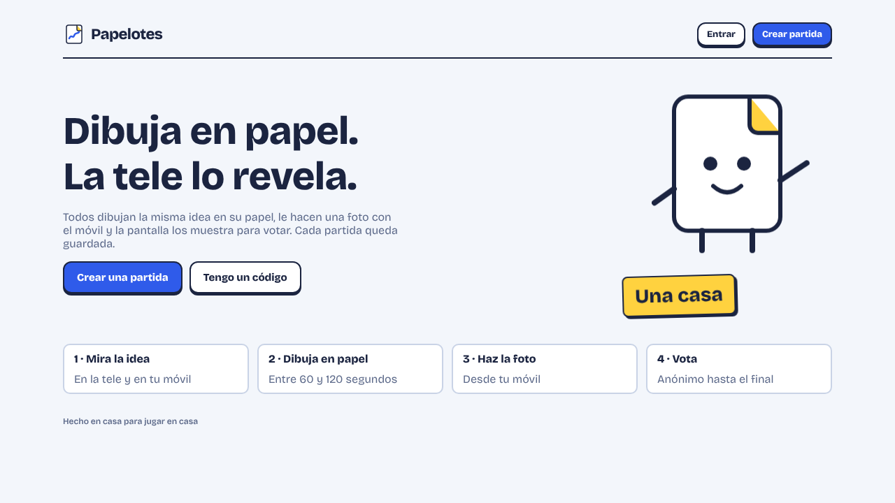
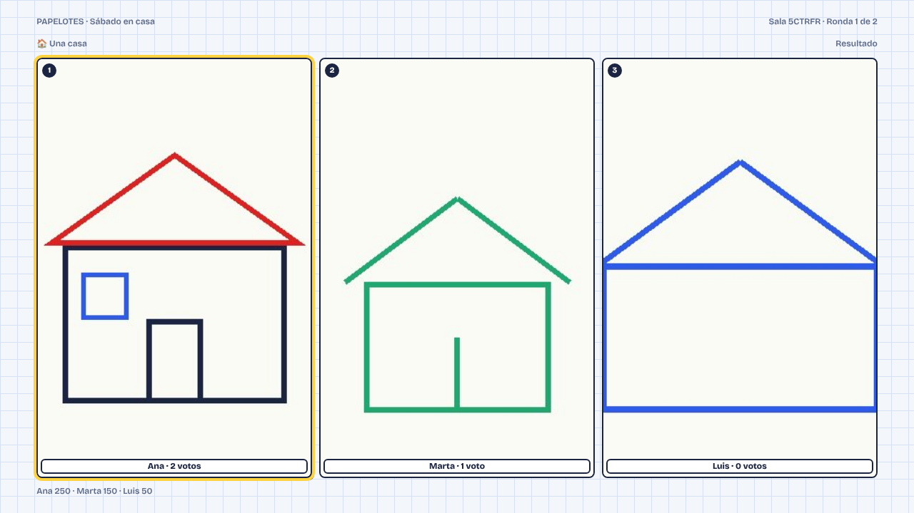
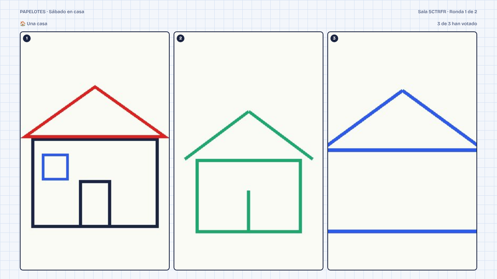
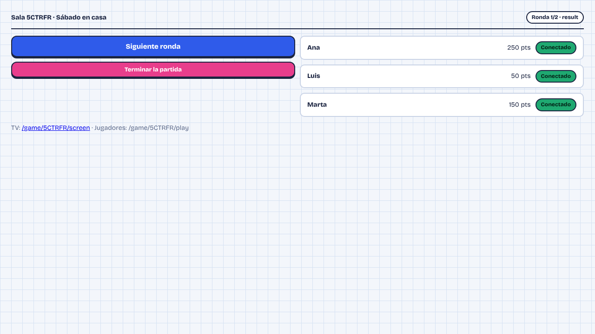
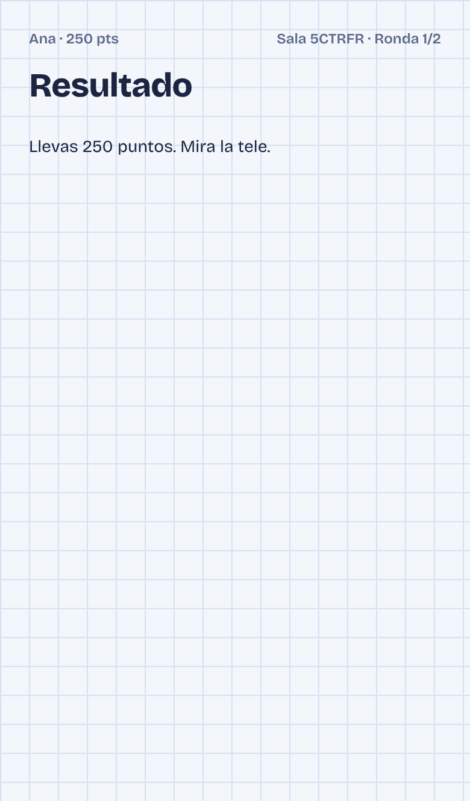

<p align="center"></p>
<p align="center"></p>

<h3 align="center">Dibuja en papel. La tele lo revela.</h3>

<p align="center">
Juego de fiesta para jugar en casa: la <b>TV</b> muestra una idea, todos <b>dibujan en papel</b>, hacen una <b>foto con el móvil</b>, la tele revela los dibujos y se <b>vota</b> el mejor. Cada partida guarda sus dibujos para verlos después.
</p>

<p align="center"></p>

> **Estado: esqueleto jugable en modo de desarrollo.** No hay despliegue ni Supabase conectado. Lo que falta y lo que no se ha probado está en [`docs/PENDIENTE.md`](docs/PENDIENTE.md). Cómo desplegarlo cuando llegue el momento: [`docs/SIGUIENTES-PASOS.md`](docs/SIGUIENTES-PASOS.md).

## Cómo se juega

| | Paso | Qué pasa |
|---|---|---|
| 1 | **Idea** | La tele y el móvil muestran qué dibujar («Una casa»). |
| 2 | **A dibujar** | Todos dibujan en su papel con un rotulador gordo. Cuenta atrás de 90 s (configurable). |
| 3 | **Foto** | Cada jugador fotografía su papel con el móvil y lo sube. |
| 4 | **Revelación** | La tele muestra los dibujos numerados y anónimos. |
| 5 | **Votación** | Cada uno vota el mejor, sin poder votar el suyo. |
| 6 | **Resultado** | Se descubre quién dibujó qué, con votos y puntos (100 por voto, +50 por entregar a tiempo). |

## Capturas

<table>
<tr>
<td><br><sub>TV · resultado de la ronda</sub></td>
<td><br><sub>TV · votación</sub></td>
</tr>
<tr>
<td><br><sub>Panel del Game Master</sub></td>
<td align="center"><br><sub>Móvil del jugador</sub></td>
</tr>
</table>

## Papelo, la mascota

<p align="center"></p>

Una hoja de cuaderno con la esquina doblada. Aparece en la portada, la sala de espera, los resultados y los estados vacíos. Las animaciones son CSS y se detienen con `prefers-reduced-motion`. Logo, iconos y favicon: [`public/brand/`](public/brand/).

## Probarlo en local
```bash
npm install
npm run dev          # modo de desarrollo: PGlite + datos en .demo-data
```
1. Abre `/new-game` para crear una sala como Game Master (sin cuenta, solo en desarrollo).
2. Abre la TV en `/game/CÓDIGO/screen` y, en otros dispositivos, `/join` o `/game/CÓDIGO/play`.
3. Con al menos 2 jugadores, empieza desde el panel `/game/CÓDIGO/host`.

```bash
npm run lint && npm run typecheck && npm test   # comprobación rápida
npm run build
```

## Cómo está hecho
- **Next.js (App Router) + TypeScript estricto + Zod.** Estilo propio en `src/app/globals.css`, portado del diseño aprobado.
- **Toda la lógica del juego vive en funciones SQL `pa_*`** (`supabase/migrations/`), con bloqueo de la partida e idempotencia. TypeScript solo valida, autentica y presenta. Arquitectura común: [PartyKit Casero](https://github.com/ElMaxter99/partykit-casero).
- **PGlite** (Postgres en WASM) para desarrollo y tests; **Supabase** queda para producción (aún sin conectar).
- Reglas de juego: [`docs/REGLAS-DE-JUEGO.md`](docs/REGLAS-DE-JUEGO.md).

## Variables de entorno
Hoy solo se leen dos, ambas para desarrollo. La lista completa para producción, con su estado, está en [`docs/SIGUIENTES-PASOS.md`](docs/SIGUIENTES-PASOS.md).

| Variable | Para qué |
|---|---|
| `ALLOW_DEMO_MODE=true` | Permite el modo de desarrollo en un build local de producción. Nunca funciona en Vercel. |
| `DEMO_DATA_DIR` | Carpeta de datos del modo de desarrollo (por defecto `.demo-data`). |

## Documentación
[`docs/README.md`](docs/README.md) · [`docs/REGLAS-DE-JUEGO.md`](docs/REGLAS-DE-JUEGO.md) · [`docs/SIGUIENTES-PASOS.md`](docs/SIGUIENTES-PASOS.md) · [`docs/PENDIENTE.md`](docs/PENDIENTE.md) · [`design/mockups.html`](design/mockups.html) (maquetas históricas)
